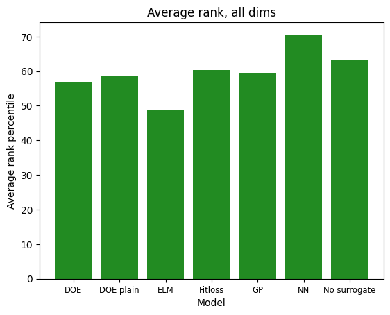

# Autoencoders in black-box optimization

My master's thesis at Charles University (2026), supervised by prof. Martin Holeňa. Can an autoencoder help an evolutionary optimizer spend fewer expensive function evaluations?

- **Problem**: black-box optimization means minimizing a function you can only evaluate, not inspect. Each evaluation may be expensive, for example a simulation or a lab run.
- **Optimizer**: CMA-ES, a strong evolutionary algorithm for this setting. Each generation it samples extra candidates, and a cheap surrogate model picks which ones get a real evaluation (preselection).
- **Method (DOE)**: a DoE2Vec-style variational autoencoder encodes a local sample of the target function. The method finds the closest match in a bank of randomly generated training functions and uses that function as the surrogate.
- **Baselines**: Gaussian process (GP), extreme learning machine (ELM), nearest neighbor (NN), simpler DOE variants, and CMA-ES with no surrogate.
- **Benchmark**: all 24 [COCO/BBOB](https://github.com/numbbo/coco) functions, dimensions 2, 5, and 10, 10 instances each. Friedman and Nemenyi tests over 720 problem blocks.

**[Read the thesis (PDF, 60 pages)](https://github.com/tzasadil/Autoencoders-in-blackbox-optimization/releases/download/thesis/thesis_Tomas_Zasadil.pdf)**

## Results

The result is negative for DOE, and the thesis shows why.



Higher is better. At each evaluation step, every model gets a rank percentile against the others on the same problem. The chart averages it over all steps, so 100 would mean first place at every step.

- **Main comparison**: NN ranks best (70.6). DOE (57.0) finishes below plain CMA-ES with no surrogate (63.4), and the gap is statistically significant.
- **Complexity does not pay off**: the simpler DOE variants are not worse. Picking by fitting loss instead of latent distance (`Fitloss`) is significantly better.
- **Diagnosis**: a separate selector experiment shows that preselection itself works. A perfect oracle scores 72.2, and an oracle that only keeps the better half of the search region slightly beats the baseline (58.7 vs 58.0). DOE narrows the search to one region, but its signal is too weak to pick the right region often enough.
- **Cost**: DOE is orders of magnitude slower than the simpler surrogates.

Per-group charts (separable, ill-conditioned, multimodal), early-budget charts, and selector diagnostics are in `graphs/`.

## Run

Results land in `data/` (CSV). COCO post-processing goes to `ppdata/`, plots to `graphs/`.

Needs Python 3.11, [uv](https://github.com/astral-sh/uv), and [just](https://github.com/casey/just).

```bash
uv sync
just run
```

`just run` does the full chain: DoE sweep, sweep plots, optimization, external COCO refs, COCO post-processing, analysis graphs.

Individual targets:

- `just sweep-doe` / `just plots-doe-sweep`: VAE hyperparameter sweep and its plots
- `just optim` / `just run-main`: full optimization (`optim` entrypoint or `main.py`)
- `just coco-external` / `just coco`: external reference bundle / post-process this repo's runs
- `just graphs`: control / thesis analysis plots

Default BBOB slice is functions 1-24, dims 2/5/10, instances 1-10, budget `250 * dim`. `just optim` runs one worker per model by default.

Optional env vars:

- `BBOB_PROBLEM_INFO`: COCO filter string
- `BBOB_MODEL_FILTER`: run only one model
- `BBOB_DATA_DIR`: CSV output directory
- `BBOB_SKIP_PLOT=1` / `BBOB_SKIP_COCO=1`: skip ranking plots or COCO post-processing

Rough layout: `main.py` / `evo.py` / `models.py` for the experiment loop, `doe2vec/` for the VAE surrogate, `control_analysis/` for the graph CLI, plus `data/`, `exdata/`, `ppdata/`, `graphs/`.
